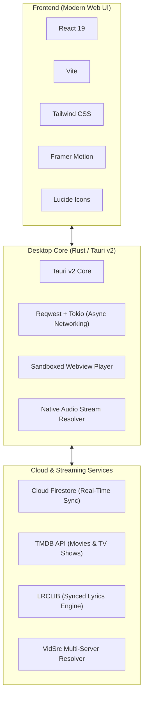

<div align="center">

# 🎵 OVILO
### The Ultimate Universal Media & Streaming Hub
**Stream Movies, TV Shows, Anime & Music with Real-Time Synced Lyrics**

[](https://github.com/rirdev/ovilo/releases)
[](https://github.com/rirdev/ovilo/releases)
[](https://tauri.app/)
[](https://react.dev/)
[](https://ovilo.netlify.app/)

<p align="center">
  <a href="#-installation"><strong>📥 Download</strong></a> •
  <a href="#-key-features"><strong>✨ Features</strong></a> •
  <a href="#-how-to-use"><strong>📖 How to Use</strong></a> •
  <a href="#-tech-stack"><strong>🛠️ Tech Stack</strong></a> •
  <a href="#-building-from-source"><strong>⚙️ Build from Source</strong></a>
</p>

---

</div>

## 🌟 Overview

**OVILO** is an all-in-one entertainment powerhouse that combines high-performance **video streaming (Movies, TV Series, Anime)** and a **music experience with real-time synchronized karaoke lyrics**. Built on a native **Rust (Tauri v2)** foundation and powered by **React 19**, **Tailwind CSS**, and **Framer Motion**, Ovilo delivers a responsive desktop and mobile media application.

---

## ✨ Key Features

### 🎬 Cinema & Video Streaming
- **Multi-Server Streaming Engine:** Dynamically switches between high-speed streaming sources (`vidsrc`, `superembed`, and mirrors) with automatic fallback.
- **Built-in Ad-Shielding:** Sandboxed player protects your experience from intrusive ads, pop-ups, and malicious redirects.
- **TV Series & Episode Navigator:** Built-in season picker, previous/next episode controls, and auto-resume markers.
- **Global Search (`Ctrl+K` / `/`):** Instant multi-category search across Movies, TV Series, Anime, and Actors powered by TMDB.

### 🎧 Universal Music & Showcase Player
- **Real-Time Synced Karaoke Lyrics:** Accurate, line-by-line synchronized lyrics powered by LRCLIB with duration matching and smooth scroll animations.
- **High-Definition Audio & Music Videos:** Stream high-quality audio tracks or watch full HD music videos.
- **Interactive Audio Visualizer:** Dynamic wave animation synchronized with audio playback.
- **Offline & Local Media Support:** Scan, organize, and play your local audio files directly inside the application.

### ☁️ Cloud Sync & Account System
- **Firebase Firestore Integration:** Keep your watch history, favorite movies, tracks, and custom playlists synchronized across all your devices.
- **Real-time Live Profile:** Custom avatars, usernames, and theme preferences stored securely in the cloud.

### 🔔 Clean OTA Update System
- **Over-the-Air Update Notifications:** Automatic in-app alerts when a new release is published with 1-click update download.
- **About & Updates Dashboard:** View system architecture, installed version, and check for updates manually with one click.

---

## 📥 Installation

Choose the download package for your operating system from the [Releases](https://github.com/rirdev/ovilo/releases) page:

### 🪟 Windows (Windows 10, 11)

| Format | Description | Instructions |
| :--- | :--- | :--- |
| **Setup Wizard (`.exe`)** | **Recommended** full installer | Double-click `Ovilo-0.1.0-Setup.exe` to run the wizard. It automatically creates Start Menu and Desktop shortcuts, and registers an uninstaller under Windows Settings. |
| **Standalone (`.zip`)** | Portable edition | Extract `ovilo-0.1.0-windows-x64.zip` and run `ovilo.exe`. |

### 🐧 Linux (All Major Distributions)

| Package | Distribution | Installation Command |
| :--- | :--- | :--- |
| **`.deb`** | Ubuntu, Debian, Linux Mint, Pop!_OS | `sudo apt install ./OVILO_0.1.0_amd64.deb` |
| **`.rpm`** | Fedora, RHEL, openSUSE | `sudo rpm -i OVILO-0.1.0-1.x86_64.rpm` |
| **`.AppImage`** | Universal (Arch, Manjaro, etc.) | `chmod +x OVILO_0.1.0_amd64.AppImage`<br/>`./OVILO_0.1.0_amd64.AppImage` |
| **`.tar.gz`** | Any Linux (with Auto-Installer) | Extract the archive and run: `./install.sh`<br/>*(Installs app menu entry, desktop shortcut, icon, and binary to `~/.local/bin`)* |

### 📱 Android (Android 8.0+)
- Download `ovilo.apk` directly to your Android device and tap to install (enable *Install unknown apps* if prompted).

---

## 📖 How to Use

### Navigation
- **Home / Cinema:** Discover trending movies, top 10 worldwide today, and binge-worthy TV series.
- **Music:** Browse trending tracks, music charts, and play your favorite artists.
- **Lyrics View:** Click the lyrics icon on the bottom player bar to toggle full-screen real-time synced lyrics.
- **Library:** Access your saved favorites, playback history, and offline downloads.
- **Settings &rarr; About & Updates:** Check for updates, inspect build metadata, or visit the official website.

### ⌨️ Keyboard Shortcuts

| Shortcut | Action |
| :--- | :--- |
| <kbd>Space</kbd> | Play / Pause media |
| <kbd>Ctrl</kbd> + <kbd>K</kbd> or <kbd>/</kbd> | Open Instant Search |
| <kbd>F</kbd> | Toggle Fullscreen |
| <kbd>M</kbd> | Mute / Unmute audio |
| <kbd>&rarr;</kbd> / <kbd>&larr;</kbd> | Seek forward / backward 10 seconds |
| <kbd>&uarr;</kbd> / <kbd>&darr;</kbd> | Increase / Decrease volume |
| <kbd>Esc</kbd> | Close overlay / modal / search |

---

## 🛠️ Tech Stack



- **Frontend:** [React 19](https://react.dev/), [Vite](https://vite.dev/), [Tailwind CSS](https://tailwindcss.com/), [Framer Motion](https://www.framer.com/motion/)
- **Native Backend:** [Rust](https://www.rust-lang.org/), [Tauri v2](https://tauri.app/), `reqwest`, `tokio`, `serde`
- **Cloud Backend:** [Firebase Cloud Firestore](https://firebase.google.com/) for cloud synchronization
- **Metadata & APIs:** [The Movie Database (TMDB)](https://www.themoviedb.org/), [LRCLIB](https://lrclib.net/)

---

## ⚙️ Building from Source

### Prerequisites
- [Rust & Cargo](https://rustup.rs/) (1.80+)
- [Node.js](https://nodejs.org/) (v18+)
- Linux dependencies (Debian/Ubuntu):
  ```bash
  sudo apt-get install libwebkit2gtk-4.1-dev build-essential curl wget file libssl-dev libgtk-3-dev libayatana-appindicator3-dev librsvg2-dev
  ```

### Development Setup
```bash
# 1. Clone the repository
git clone https://github.com/rirdev/ovilo.git
cd ovilo

# 2. Install dependencies
npm install

# 3. Start development server with live reload
npm run tauri dev
```

### Packaging Releases
```bash
# Compile optimized production binaries (deb, rpm, AppImage)
npm run tauri build
```

---

## 🛡️ License & Disclaimer

This software is developed strictly for educational, research, and personal media curation purposes. All media content is sourced from third-party public APIs and services. OVILO does not host or store any copyrighted video or audio streams on its own servers.

---

<div align="center">
  <b>Crafted by <a href="https://github.com/rirdev">@rirdev</a></b> • 
  <a href="https://ovilo.netlify.app/">ovilo.netlify.app</a>
</div>
